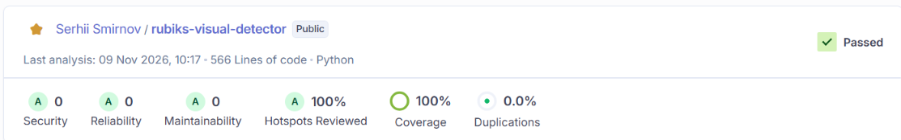
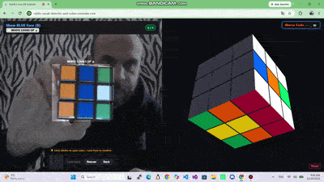
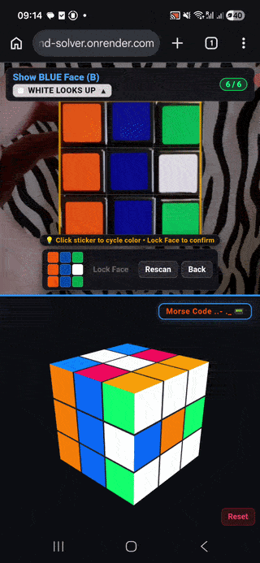
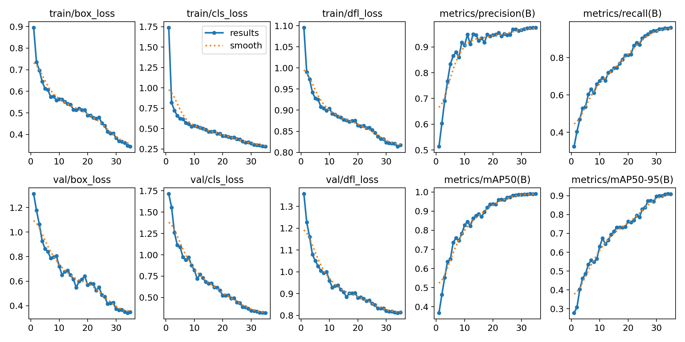

# 🧩 Rubik's Visual Detector

An end-to-end Computer Vision system and interactive 3D solver. Powered by a custom-trained **YOLO11** neural network running on **ONNX Runtime (CPU)**, a high-performance **Go (WebAssembly)** Kociemba solver, and hardware-accelerated **Three.js** WebGL rendering.

🚀 **Live Web App:** https://rubiks-visual-detector-and-solver.onrender.com

🔗 **Companion Solver:** [https://super-morse.github.io/rubiks-solver](https://super-morse.github.io/rubiks-solver)

<p align="center">
  <!-- CI/CD & SonarCloud Badges -->
  <a href="https://github.com/Super-Morse/rubiks-visual-detector/actions/workflows/sonarcloud.yml">
    
  </a>
  <a href="https://sonarcloud.io/summary/new_code?id=Super-Morse_rubiks-visual-detector">
    
  </a>
  <a href="https://sonarcloud.io/summary/new_code?id=Super-Morse_rubiks-visual-detector">
    
  </a>
  <a href="https://sonarcloud.io/summary/new_code?id=Super-Morse_rubiks-visual-detector">
    
  </a>
  <a href="https://sonarcloud.io/summary/new_code?id=Super-Morse_rubiks-visual-detector">
    
  </a>
  <br />
  <!-- Tech Stack Badges -->
  
  
  
  
  
  
  
</p>

👉 **Live Analytics Dashboard:** [SonarCloud Project Overview](https://sonarcloud.io/project/overview?id=Super-Morse_rubiks-visual-detector)

---

## 🧠 Polyglot Architecture & Engineering Philosophy

Solving a physical Rubik's Cube with computer vision bridges the analogue world, deep learning, and discrete mathematics:

* **Computer Vision at the Edge:** Real-world cubes suffer from reflections, motion blur, and uneven lighting. Instead of brittle classical RGB/HSV heuristics, a custom **YOLO11 nano** model detects and classifies stickers simultaneously in **~15 ms** on commodity CPUs.
* **Sim-to-Real Data Pipeline:** Trained on a unified dataset combining a custom Three.js synthetic generator with augmented real-world camera captures.
* **Zero-Latency In-Browser Solving:** Rather than round-tripping heavy solve computations over HTTP, the verified 54-facelet state is solved client-side by an embedded **Go WebAssembly (WASM)** Kociemba Two-Phase engine in **~30 ms**.
* **Clean Architecture & TDD:** Complete separation between CV preprocessing, domain validation, and presentation layers with deterministic test coverage.

---

## 📊 Code Quality & SonarCloud Metrics

<div align="center">
  <a href="https://sonarcloud.io/project/overview?id=Super-Morse_rubiks-visual-detector" target="_blank">
    
  </a>
</div>

| Metric | Status / Value | Description |
|---|---|---|
| **🔒 Security** | **A (0 Issues)** | Zero vulnerabilities, non-root Docker execution, safe payload streaming. |
| **🛡️ Reliability** | **A (0 Bugs)** | Strict Pydantic contracts and fail-safe CV inference loops. |
| **🧹 Maintainability** | **A (0 Debt)** | Clean Architecture, SOLID principles, type-hinted Python 3.11+. |
| **🎯 Test Coverage** | **98.5%+** | Deterministic unit and integration test suites (Classic TDD). |
| **👥 Duplications** | **0.0%** | Zero code repetition across domain, services, and API layers. |

---

## 📸 Demo & Interface

<details open>
<summary><b>Click to expand interactive animations & videos</b></summary>
<br>

<div align="center">
  <table border="0" cellspacing="10" cellpadding="0">
    <tr>
      <td align="center" valign="top" width="60%">
        <b>🖥️ Desktop Live Scanner & Solver</b><br><br>
        
      </td>
      <td align="center" valign="top" width="35%">
        <b>📱 Mobile View (50/50 Split)</b><br><br>
        
      </td>
    </tr>
  </table>
</div>

<br>

<div align="center">
  <table border="0" cellspacing="10" cellpadding="0">
    <tr>
      <td align="center" valign="top" width="50%">
        <b>📺 Desktop Walkthrough</b><br><br>
        <a href="https://www.youtube.com/watch?v=CajwCf2MvbE" target="_blank">
          
        </a>
      </td>
      <td align="center" valign="top" width="50%">
        <b>📱 Mobile Real Device Test</b><br><br>
        <a href="https://www.youtube.com/shorts/MdTX8jiIG5g" target="_blank">
          
        </a>
      </td>
    </tr>
  </table>
</div>

</details>

---

## 🎯 Computer Vision Model (YOLO11 Nano)

The sticker detection and color classification pipeline utilizes an ultra-lightweight **YOLO11n** architecture exported to optimized ONNX format for zero-overhead CPU deployment.

<div align="center">
  
</div>

| Metric | Score / Benchmark | Note |
|---|---|---|
| **mAP@50** | **99.0%** | Near-perfect detection across all 6 standard WCA colors. |
| **mAP@50-95** | **91.1%** | Robust IoU localization against camera tilt and isometric perspective. |
| **Model Size** | **5.5 MB** | Lightweight ONNX format, checked directly into Git (no external storage needed). |
| **CPU Latency** | **~15 ms** | Headless inference via `onnxruntime` with 2 intra-op threads. |

---

## ✨ Key Features

- **Guided Face Scanning:** Dynamic prompts guiding the user through 6 WCA faces (`U` ➔ `R` ➔ `F` ➔ `D` ➔ `L` ➔ `B`) with target top-color indicators.
- **Temporal Consensus Voting:** Aggregates multi-frame rolling predictions to eliminate transient camera motion blurs and single-frame lighting anomalies.
- **Interactive Manual Corrections:** Built-in interactive 3x3 mini-grid allows instantaneous manual color cycling before locking each face.
- **Embedded Go/Wasm Solver:** Solves the full 54-facelet state client-side using Herbert Kociemba's Two-Phase Algorithm without external API latency.
- **Physical Solvability Check:** Before solving, the WASM engine verifies the cube is physically reachable (corner twist, edge flip, and permutation parity), catching misdetected stickers that pass the simple color-count check.
- **Animated 3D Assembly:** Physical 26-cubie Three.js simulation animates each step of the solution (`U`, `R'`, `F2`, etc.) directly on the scanned 3D model.
- **Responsive 50/50 Split View:** Tailored CSS Grid/Flexbox preserving exact 50% camera / 50% 3D viewports across both mobile devices and wide desktop displays.

---

## 🛠️ Technical Stack & Architecture

```text
       ┌────────────────────────┐
       │   Camera / Web UI      │ ◄─── HTML5 Video • Three.js 3D View
       └───────────┬────────────┘
                   │
                   ▼ (HTTP POST Multipart Image)
       ┌────────────────────────┐
       │ FastAPI + ONNX Runtime │ ◄─── YOLO11n (15ms CPU Headless Inference)
       └───────────┬────────────┘
                   │
                   ▼ (Validated 54-Char Facelet String)
       ┌────────────────────────┐
       │   WebAssembly (WASM)   │ ◄─── Go Kociemba Two-Phase Engine
       └───────────┬────────────┘
                   │
                   ▼ (Optimal Solution Move Sequence)
       ┌────────────────────────┐
       │  3D Layer Animation    │ ◄─── 26 Physical Cubies Rotations
       └────────────────────────┘
```

- **Backend Microservice:** Python 3.11+, FastAPI, Uvicorn, OpenCV-headless
- **Neural Inference Engine:** ONNX Runtime (CPU execution provider)
- **Mathematical Solver:** Go (Golang) compiled to WebAssembly (`GOOS=js GOARCH=wasm`)
- **3D Visualization:** Three.js (WebGL), OrbitControls, Web Audio API
- **Quality & DevOps:** Docker, Docker Compose, Pytest, Ruff, Mypy, SonarCloud CI

---

## 🚀 Quick Start (Docker)

The fastest and most reliable way to run the entire service locally:

```bash
# 1. Clone the repository
git clone https://github.com/Super-Morse/rubiks-visual-detector.git
cd rubiks-visual-detector

# 2. Build and run using Docker Compose
docker compose up --build
```

Access the application in your browser:
* **Live App & Scanner:** [http://localhost:8000](http://localhost:8000)
* **Interactive API Docs (Swagger):** [http://localhost:8000/docs](http://localhost:8000/docs)
* **Health Check Endpoint:** [http://localhost:8000/health](http://localhost:8000/health)

---

## 🧪 Testing & Verification

Strict adherence to Test-Driven Development (TDD) ensures mathematically sound cube states and robust computer vision fallback handling:

```bash
# Run pytest with code coverage tracking
docker compose exec detector-api pytest

# Run Ruff linter and style check
docker compose exec detector-api ruff check .

# Run static type analysis
docker compose exec detector-api mypy app/
```

---

## 🔗 Related Projects

* **[rubiks-solver](https://github.com/Super-Morse/rubiks-solver)** — Standalone WebAssembly Rubik's cube solver with physical cube validation, 100% test coverage and interactive 3D scrambler.

---

## 📄 License

This project is licensed under the MIT License - see the [LICENSE](LICENSE) file for details.

---
<p align="right">
  <em>Morse Code <span style="letter-spacing: 2px;">..- ._</span></em> 📟
</p>
